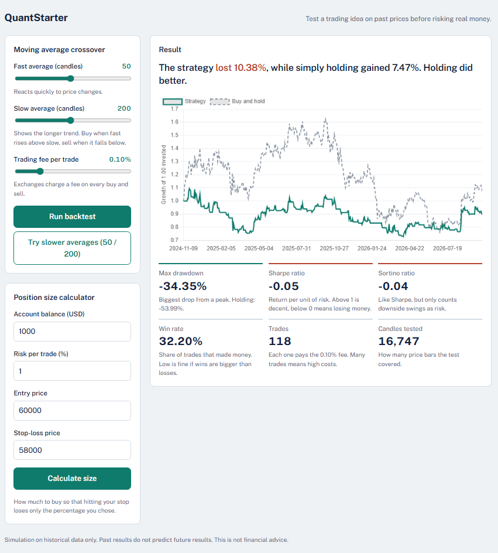

# QuantStarter


A small, beginner-friendly toolkit for testing crypto trading ideas on historical prices before risking real money.

Pick a strategy and its settings in a web dashboard. QuantStarter shows how it would have performed compared with simply holding the coin, including trading fees and risk measures, and it checks the idea on data it was not set up on, so you can see overfitting for yourself.



> **Educational use only.** Backtests are simulations on historical data. Past results do not predict future results. Nothing here is financial advice.

**New here?** Follow the step-by-step walkthrough in [docs/GETTING_STARTED.md](docs/GETTING_STARTED.md). It goes from an empty computer to your first result, and includes fixes for the most common setup problems.

## Features

- **Six example strategies:** moving average crossover, RSI mean reversion, breakout, Bollinger Bands, momentum, and a trend rule that stands aside when the market is jumpy
- **Unseen test period:** the newest 30% of the data is held back, and results are shown for training and test side by side
- **"Find best settings" optimizer:** tries many settings on the training data only, then reveals how the winner does on unseen data (an overfitting demo)
- **Walk-forward test:** repeats the train/test routine over several sliding windows, so you can see whether an idea wins consistently or only once
- **Hourly, 4-hour and daily candles:** daily data from Yahoo goes back many years, which gives far more trades and market phases to test on than two years of hourly data
- **Export:** every result has **CSV** and **JSON** download buttons, with the settings used saved alongside, so runs can be kept, compared and attached to bug reports
- **Long and short:** strategies can also go short, to profit from falling prices, with a funding-cost setting (long only is the default)
- **Several coins:** download more than one asset and pick the data in the dashboard, or run **Compare across assets** to see whether an idea holds beyond Bitcoin
- **Realistic costs:** a slippage setting on top of the fee, and a **cost stress test** that shows how the result changes as trading costs rise and at what cost the profit disappears
- **Settings map:** colour grids of neighbouring settings, scored on training and unseen data next to buy and hold, so a lone lucky setting (or a result that just follows the market) stands out from a broad region that works
- **Plain-language results:** verdict sentence, equity chart against buy and hold, and metrics with short explanations
- **Risk metrics:** total return, max drawdown, Sharpe, Sortino, win rate, number of trades, and time in market
- **Learn tab:** short explanations of backtests, fees, drawdown, Sharpe and overfitting, with two small interactive calculators
- **Position size calculator:** how much to buy so that a stop-loss costs only the percentage you chose
- **Easy to extend:** a new strategy is one function plus one list entry
- **Optional C++ indicators** with an automatic pandas fallback
- **Tests and CI** on Linux and Windows

## How it fits together

```
Exchange / Yahoo -> collector -> MySQL (candles) -> engine -> API -> dashboard
```

| Part | Language | What it does |
|---|---|---|
| `collector/` | Python | Downloads price candles (OHLCV) from exchanges via `ccxt`, or from Yahoo Finance as a fallback, and saves them to MySQL |
| `engine/` | Python | Strategies, backtest simulation, metrics, and a terminal report |
| `api/` | Python (FastAPI) | Serves strategies, backtests and optimizer results as JSON |
| `dashboard/` | JavaScript | Single-page web UI with controls, chart and tables |
| `cpp/` | C++ | Optional fast indicators, loaded with `ctypes` |
| `db/` | SQL | MySQL schema |

## Requirements

- Python 3.11 or newer
- MySQL 8 (or MariaDB). Easiest options: [Laragon](https://laragon.org) on Windows, or Docker on any system
- A modern web browser
- Optional: a C++ compiler (`g++`) for the fast indicators

## Setup

### 1. Get the code

```bash
git clone https://github.com/Vandergils/quantstarter.git
cd quantstarter
```

### 2. Start MySQL

**Option A: Laragon (Windows, light on RAM).** Open Laragon, click **Start All**, open phpMyAdmin (`http://localhost/phpmyadmin`) and run the contents of `db/schema.sql` in the SQL tab.

**Option B: Docker.**

```bash
docker compose up -d
```

The database and table are created automatically from `db/schema.sql`. Change the password in `docker-compose.yml` before using it for anything beyond local testing. *The Docker setup is untested by the author. Please open an issue if it fails.*

### 3. Configure the database connection

Copy the example settings and edit them to match your MySQL:

```bash
cp collector/.env.example collector/.env        # macOS / Linux
copy collector\.env.example collector\.env      # Windows (cmd)
```

Laragon's default is user `root` with an empty password. If you use Docker, set `DB_PASSWORD` to the password from `docker-compose.yml`. The `.env` file is ignored by git, so your password is never uploaded.

### 4. Install Python packages

A virtual environment keeps things tidy:

```bash
python -m venv .venv
.venv\Scripts\activate          # Windows
# source .venv/bin/activate     # macOS / Linux
python -m pip install -r requirements.txt
```

### 5. Download price data

Pick one:

```bash
python collector/collect.py          # from an exchange via ccxt
python collector/collect_yahoo.py                  # from Yahoo Finance (BTC-USD), no API key needed
python collector/collect_yahoo.py ETH-USD SOL-USD  # one or more other tickers
python collector/collect_yahoo.py BTC-USD --timeframe 1d  # daily candles, many years of history
python collector/collect_yahoo.py BTC-USD --timeframe 4h  # 4-hour candles, built from the hourly data
```

Some networks or regions block exchange APIs. If `collect.py` fails with a network error, `collector/test_exchanges.py` shows which exchanges your connection can reach, and `collect_yahoo.py` is the fallback. Hourly Yahoo data covers roughly the last two years (and so do 4-hour candles, which are built from it), while daily data goes back much further.

The dashboard's **Data** menu lists whatever is in your database, so any ticker or exchange you collected can be chosen there together with its timeframe (15m, 30m, 1h, 2h, 4h and 1d are supported). Running the collector again only adds new candles. Strategy settings count candles, so a slow average of 50 means 50 hours on hourly data and 50 days on daily data. The terminal tools use `yahoo`, `BTC/USD` and `1h` unless you pass `--exchange`, `--symbol` or `--timeframe`.

### 6. Compare the strategies in the terminal

```bash
python engine/backtest.py     # all strategies, default settings, full period
python engine/report.py       # training vs unseen test, plus the optimizer's best settings
python engine/report.py --symbol ETH/USD --timeframe 1d   # another coin or timeframe
```

### 7. Start the API and open the dashboard

```bash
python -m uvicorn api.main:app --reload
```

Then open `dashboard/index.html` in your browser. With Laragon you can also use `http://localhost/quantstarter/dashboard/`. Interactive API docs are at `http://127.0.0.1:8000/docs`.

## Using the dashboard

1. Choose the **data** (Bitcoin by default) and a **strategy**, and adjust its settings.
2. Keep the **unseen test** on (it defaults to the last 30% of the data).
3. Press **Run backtest** to see the equity curve and the numbers.
4. Press **Find best settings** to see how the best setting from the training data holds up on unseen data.
5. Press **Run walk-forward test** to repeat that over several time windows and check consistency.
6. Press **Draw settings map** to see whether a good result is a lone lucky spike or a broad region of settings that work.
7. Press **Compare across assets** to run the same settings on every coin in your database.
8. Choose **Direction: Long and short** (and set a funding cost) to let strategies profit from falling prices.
9. Press **Cost stress test** to see at what trading cost the profit disappears. Set **Slippage** above zero for a more realistic result in every other view.
10. Open the **Learn** tab if any of the terms are new.

## Exporting results

Every result panel ends with **Download these results: CSV, JSON**.

- **JSON** holds the full result plus the settings that produced it (data, timeframe, strategy, settings, direction, fee, slippage, funding).
- **CSV** is a tidy table with the same settings repeated in the first columns of every row, so files from different runs can simply be stacked in a spreadsheet and compared.
- Columns ending in `_pct` are percentages (`12.5` means 12.5%). Sharpe and Sortino are plain numbers.
- For the optimizer, walk-forward test and settings map, the `settings` column says what was searched or varied, because those tools choose settings themselves.
- Files are created in your browser. Nothing is uploaded anywhere.

## How to read the results

Read the **Unseen test** column first. That is the closest thing to an honest result.

| Metric | What it tells you |
|---|---|
| Strategy vs buy and hold return | Did the idea beat doing nothing? |
| Max drawdown | The worst fall from a peak. Could you sit through it? |
| Sharpe ratio | Return per unit of risk. Roughly: above 1 is decent, below 0 lost money |
| Trades | Every trade pays the fee. Hundreds usually means fees dominate, and a handful means the result may be luck |
| Win rate | Share of trades that made money. Low is fine if winners are much bigger than losers |
| Training vs test | If it only works on the training part, it probably fit past noise (overfitting) |

A result looks promising only if it holds up when you raise the fee, change the settings slightly, and test a different time period.

### What the example results taught

On hourly BTC-USD data from November 2024 to October 2026 (0.1% fee), the author found that **none of the first three example strategies (moving average, RSI, breakout) showed convincing out-of-sample profit**. The strategies added afterwards (Bollinger Bands, momentum, and the calm-market trend rule) are not covered by this summary, so run the checks on them yourself:

- **A single split looked promising, then fell apart.** With the last 30% held back, the best Breakout setting returned +14.2% against +15.7% for holding, with a much smaller drawdown (-11.0% vs -29.7%). The best RSI setting returned +30.6% on training and then **lost 8.7%** on unseen data, which is overfitting.
- **Walk-forward was harsher.** Over five unseen windows, the moving average strategy was profitable in only one. It lost less than holding in four of them, but holding itself lost money in four of the five windows, so that is *protection, not profit*: any strategy that sits in cash during a fall loses less. Breakout and RSI also showed no evidence of profit.
- **Fees matter.** The default RSI made hundreds of trades, and at 0.1% per trade the fees alone took a large share of the account.
- **One test period is a small sample.** The last part of the data was a rising market, which flattered every trend-following rule. Repeating the test across windows is what exposed it.

Your numbers will differ depending on when you download the data. The lessons usually stay the same: check unseen data, compare with buy and hold, count the trades, and look across several windows.

## The strategies

By default the strategies are long-only: for each candle the strategy either holds the coin or sits in cash. In **Long and short** mode each strategy also has a short side (the mirror image of its rules), so it can profit when prices fall. Every trade happens on the **next** candle, so a strategy never uses information it could not have had yet.

| Strategy | Idea | Tends to struggle when |
|---|---|---|
| Moving average crossover | Buy when the fast average rises above the slow one (trend following) | The market moves sideways and the signal flips constantly |
| RSI mean reversion | Buy after a sharp drop, sell once the price recovers | The price keeps falling after the dip |
| Breakout | Buy a new N-candle high, sell a new low over half that period | False breakouts reverse straight away |
| Bollinger Bands | Buy when price drops below the lower band (average minus N standard deviations), sell when it returns to the average | The price keeps falling after the dip, or the bands are so wide that it almost never trades |
| Momentum | Hold while the price is above where it was N candles ago (short while below, in long and short mode) | The market chops sideways, so the direction keeps flipping |
| Trend, calm markets only | Hold while the price is above its average and volatility is not far above normal | Strong trends that start in volatile phases are missed, and a filter that is too strict leaves it mostly in cash |

## Add your own strategy

Strategies live in `engine/strategies.py`. Write a function that returns a 0/1 signal for every candle, then add it to the `STRATEGIES` list with its settings:

```python
def sig_momentum(df, lookback=72):
    """Hold while the price is higher than it was `lookback` candles ago."""
    return (df["close"] > df["close"].shift(lookback)).astype(int)
```

The API, optimizer and dashboard pick it up automatically. To let it run in long and short mode, also add a short function (it returns 1 while the strategy wants to be short) as `"short_func"`. See [CONTRIBUTING.md](CONTRIBUTING.md) for the full example and the rules (no look-ahead, integer settings, fees applied for you).

## Optional: faster indicators with C++

The project works without this. If you have a C++ compiler, build a native library for faster indicators:

```bash
python cpp/build.py
python cpp/benchmark.py
```

If the library is not built, the pandas versions run instead and give the same numbers. On Windows, `g++` comes with [MSYS2](https://www.msys2.org): open the **MSYS2 UCRT64** terminal and run `pacman -S mingw-w64-ucrt-x86_64-gcc`. The compiled `.dll` / `.so` file is ignored by git, so everyone builds their own.

## Tests

```bash
python -m pip install pytest
python -m pytest tests
```

Tests need no database or internet. The tests for the C++ library are skipped if it is not built. GitHub runs the tests automatically on every push.

## Known limits

- Results come from a limited time span, so a single test period is a small sample.
- **Short selling is simplified.** A short is modelled as -1x exposure, charged the fee on every change of position (a flip from long to short counts as two trades) and an optional yearly funding cost. Liquidation, margin limits, borrow availability and funding rates that change over time are not modelled, so real short results can be worse. Zero funding flatters shorts.
- Costs are modelled as a fee plus a flat slippage per trade. Real trading also has order-size effects, delays and exchange downtime.
- Sharpe and Sortino are scaled to a year using the timeframe of the data (`PERIODS_PER_YEAR` in `engine/metrics.py`, with a 365-day crypto year), so they are not comparable between hourly and daily data.
- The API allows requests from any origin, which is fine for local use but should be restricted before any deployment.

## Project layout

```
quantstarter/
├── README.md
├── CONTRIBUTING.md
├── CHANGELOG.md
├── LICENSE
├── requirements.txt
├── docker-compose.yml
├── .github/workflows/tests.yml
├── db/schema.sql
├── collector/
│   ├── collect.py
│   ├── collect_yahoo.py
│   ├── test_exchanges.py
│   └── .env.example
├── engine/
│   ├── strategies.py       strategies and the shared simulation
│   ├── backtest.py         data loading and a terminal comparison
│   ├── metrics.py          return, drawdown, Sharpe, Sortino, win rate, position size
│   ├── walkforward.py      walk-forward test across sliding windows
│   ├── sensitivity.py      settings map: a grid of neighbouring settings
│   ├── compare.py          the same strategy run across several assets
│   ├── costs.py            cost stress test and break-even cost
│   ├── fast.py             indicators: C++ if built, pandas otherwise
│   ├── report.py           training vs unseen test report
│   └── sweep.py
├── cpp/
│   ├── indicators.cpp
│   ├── build.py
│   └── benchmark.py
├── api/main.py
├── dashboard/index.html
├── docs/
│   ├── GETTING_STARTED.md
│   └── screenshot.png
└── tests/
```

## Contributing

Ideas that would help:

- More strategies (Bollinger Bands, momentum, volatility filters)
- Non-crypto assets, and exchange data for 4-hour candles with a longer history
- Leverage, position sizing, and a more realistic short model (liquidation, changing funding)
- Order-size-aware slippage (cost that grows with position size)

See [CONTRIBUTING.md](CONTRIBUTING.md). Issues and pull requests are welcome.

## License

MIT. See [LICENSE](LICENSE).